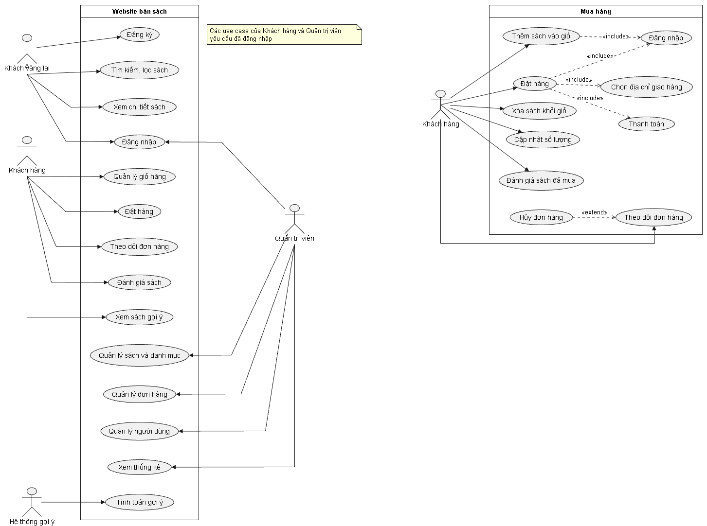

# Đặc tả yêu cầu phần mềm (SRS)

## 1. Giới thiệu

### 1.1. Mục đích
Tài liệu mô tả các yêu cầu của website thương mại điện tử bán sách tích hợp hệ thống gợi ý sách cá nhân hóa, làm cơ sở cho thiết kế, cài đặt và kiểm thử.

### 1.2. Phạm vi
Hệ thống gồm hai phần:
- **Website thương mại điện tử bán sách:** quản lý tài khoản, sách, danh mục, tìm kiếm, giỏ hàng, đặt hàng, đánh giá.
- **Hệ thống gợi ý:** dùng Collaborative Filtering (User-based, Item-based) trên dữ liệu đánh giá và hành vi người dùng để đề xuất sách tại khu vực "Dành cho bạn".

**Ngoài phạm vi** (theo đề cương đã duyệt): quản lý kho quy mô lớn, logistics, đối soát thanh toán, chống gian lận, mô hình gợi ý dựa trên học sâu.

### 1.3. Thuật ngữ

| Thuật ngữ | Giải thích |
|---|---|
| CF | Collaborative Filtering – lọc cộng tác |
| Explicit feedback | Phản hồi tường minh: điểm đánh giá 1–5 sao |
| Implicit feedback | Phản hồi ngầm định: xem, thêm giỏ, mua |
| Cold-start | Tình trạng thiếu dữ liệu với người dùng hoặc sách mới |
| JWT | JSON Web Token – chuỗi xác thực gửi kèm mỗi request |

## 2. Tác nhân

| Tác nhân | Mô tả |
|---|---|
| Khách vãng lai | Chưa đăng nhập. Xem, tìm kiếm sách, đăng ký, đăng nhập |
| Khách hàng | Đã đăng nhập (`CUSTOMER`). Có toàn bộ quyền của khách vãng lai, cộng thêm mua hàng, đánh giá, nhận gợi ý |
| Quản trị viên | `ADMIN`. Quản lý sách, danh mục, đơn hàng, người dùng, xem thống kê |
| Hệ thống gợi ý | Tác nhân hệ thống, chạy định kỳ để tính lại kết quả gợi ý |

## 3. Yêu cầu chức năng

Mức ưu tiên: **Cao** = bắt buộc cho bản demo, **TB** = cần có trong sản phẩm cuối, **Thấp** = làm nếu còn thời gian.

### 3.1. Tài khoản

| Mã | Chức năng | Tác nhân | Ưu tiên | Trạng thái |
|---|---|---|---|---|
| FR-01 | Đăng ký tài khoản | Khách vãng lai | Cao | Đã làm (API) |
| FR-02 | Đăng nhập | Khách vãng lai | Cao | Đã làm (API) |
| FR-03 | Đăng xuất | Khách hàng, Admin | Cao | |
| FR-04 | Khôi phục mật khẩu | Khách vãng lai | Thấp | |
| FR-05 | Xem, cập nhật thông tin cá nhân | Khách hàng | TB | Đã làm xem (API) |
| FR-06 | Đổi mật khẩu | Khách hàng | TB | |
| FR-07 | Quản lý địa chỉ giao hàng | Khách hàng | Cao | |

### 3.2. Sách

| Mã | Chức năng | Tác nhân | Ưu tiên | Trạng thái |
|---|---|---|---|---|
| FR-10 | Xem danh sách sách, phân trang | Mọi người | Cao | |
| FR-11 | Tìm kiếm sách theo tên, tác giả | Mọi người | Cao | |
| FR-12 | Lọc theo thể loại, tác giả, NXB, khoảng giá, tình trạng còn hàng | Mọi người | Cao | |
| FR-13 | Sắp xếp theo giá, mới nhất, đánh giá | Mọi người | TB | |
| FR-14 | Xem chi tiết sách, đánh giá, sách liên quan | Mọi người | Cao | |

### 3.3. Mua hàng

| Mã | Chức năng | Tác nhân | Ưu tiên | Trạng thái |
|---|---|---|---|---|
| FR-20 | Thêm sách vào giỏ hàng | Khách hàng | Cao | |
| FR-21 | Xem, cập nhật số lượng, xóa sách trong giỏ | Khách hàng | Cao | |
| FR-22 | Đặt hàng | Khách hàng | Cao | |
| FR-23 | Thanh toán (COD, thanh toán trực tuyến mô phỏng) | Khách hàng | TB | |
| FR-24 | Xem lịch sử và trạng thái đơn hàng | Khách hàng | Cao | |
| FR-25 | Hủy đơn hàng khi đơn còn ở trạng thái chờ xác nhận | Khách hàng | TB | |

### 3.4. Đánh giá

| Mã | Chức năng | Tác nhân | Ưu tiên | Trạng thái |
|---|---|---|---|---|
| FR-30 | Đánh giá, bình luận, chấm điểm sách đã mua | Khách hàng | Cao | |
| FR-31 | Sửa đánh giá của mình | Khách hàng | Thấp | |

### 3.5. Gợi ý cá nhân hóa

| Mã | Chức năng | Tác nhân | Ưu tiên | Trạng thái |
|---|---|---|---|---|
| FR-40 | Ghi nhận hành vi: xem, thêm giỏ, mua | Hệ thống | Cao | |
| FR-41 | Tính gợi ý bằng Collaborative Filtering theo lô định kỳ | Hệ thống gợi ý | Cao | |
| FR-42 | Hiển thị sách gợi ý tại trang "Dành cho bạn" | Khách hàng | Cao | |
| FR-43 | Gợi ý dự phòng (sách phổ biến, đánh giá cao) cho người dùng mới chưa có dữ liệu | Hệ thống | Cao | |
| FR-44 | Đánh giá mô hình bằng Precision@K, Recall@K | Hệ thống gợi ý | Cao | |

### 3.6. Quản trị

| Mã | Chức năng | Tác nhân | Ưu tiên | Trạng thái |
|---|---|---|---|---|
| FR-50 | Quản lý sách (thêm, sửa, xóa) | Admin | Cao | |
| FR-51 | Quản lý danh mục, thể loại, tác giả, NXB | Admin | Cao | |
| FR-52 | Quản lý tồn kho | Admin | TB | |
| FR-53 | Quản lý đơn hàng, cập nhật trạng thái | Admin | Cao | |
| FR-54 | Quản lý người dùng, khóa/mở khóa, phân quyền | Admin | TB | |
| FR-55 | Thống kê doanh thu, sách bán chạy | Admin | TB | |
| FR-56 | Theo dõi hiệu quả hệ thống gợi ý | Admin | TB | |

## 4. Yêu cầu phi chức năng

| Mã | Loại | Yêu cầu |
|---|---|---|
| NFR-01 | Bảo mật | Mật khẩu băm bằng BCrypt, không lưu mật khẩu gốc |
| NFR-02 | Bảo mật | Xác thực bằng JWT; khóa ký lấy từ biến môi trường, không lưu trong mã nguồn |
| NFR-03 | Bảo mật | Phân quyền theo vai trò: API quản trị chỉ `ADMIN` gọi được |
| NFR-04 | Bảo mật | Thông báo lỗi đăng nhập không tiết lộ email nào đã đăng ký |
| NFR-05 | Toàn vẹn dữ liệu | Ràng buộc khóa ngoại, transaction (InnoDB); đơn hàng lưu giá tại thời điểm mua |
| NFR-06 | Hiệu năng | Danh sách sách có phân trang; kết quả gợi ý được tính sẵn, không tính lúc tải trang |
| NFR-07 | Giao diện | Responsive trên máy tính và điện thoại |
| NFR-08 | Ngôn ngữ | Giao diện và thông báo lỗi bằng tiếng Việt |
| NFR-09 | Khả năng bảo trì | Tách lớp controller – service – repository; tài liệu lưu chung repository với mã nguồn |

## 5. Use case

### Sơ đồ use case

Bên trái là sơ đồ tổng quát, bên phải là sơ đồ phân rã chức năng mua hàng.

### Danh sách use case

| Mã | Use case | Tác nhân | Yêu cầu liên quan |
|---|---|---|---|
| UC-01 | Đăng ký | Khách vãng lai | FR-01 |
| UC-02 | Đăng nhập | Khách vãng lai | FR-02 |
| UC-03 | Tìm kiếm, lọc sách | Mọi người | FR-10 đến FR-13 |
| UC-04 | Xem chi tiết sách | Mọi người | FR-14, FR-40 |
| UC-05 | Quản lý giỏ hàng | Khách hàng | FR-20, FR-21 |
| UC-06 | Đặt hàng | Khách hàng | FR-22, FR-23 |
| UC-07 | Theo dõi đơn hàng | Khách hàng | FR-24, FR-25 |
| UC-08 | Đánh giá sách | Khách hàng | FR-30, FR-31 |
| UC-09 | Xem sách gợi ý | Khách hàng | FR-42, FR-43 |
| UC-10 | Quản lý sách và danh mục | Admin | FR-50 đến FR-52 |
| UC-11 | Quản lý đơn hàng | Admin | FR-53 |
| UC-12 | Quản lý người dùng | Admin | FR-54 |
| UC-13 | Xem thống kê | Admin | FR-55, FR-56 |
| UC-14 | Tính toán gợi ý | Hệ thống gợi ý | FR-41, FR-44 |

### Đặc tả chi tiết

#### UC-01: Đăng ký

| Mục | Nội dung |
|---|---|
| Tác nhân | Khách vãng lai |
| Tiền điều kiện | Chưa đăng nhập |
| Hậu điều kiện | Tài khoản `CUSTOMER` được tạo, người dùng ở trạng thái đã đăng nhập |
| Luồng chính | 1. Người dùng mở trang đăng ký. 2. Nhập họ tên, email, mật khẩu, số điện thoại. 3. Hệ thống kiểm tra dữ liệu. 4. Hệ thống kiểm tra email chưa tồn tại. 5. Hệ thống băm mật khẩu, lưu tài khoản. 6. Hệ thống trả về token và chuyển về trang chủ |
| Luồng thay thế | 3a. Dữ liệu sai: hiển thị lỗi tại từng trường. 4a. Email đã tồn tại: báo "Email đã được sử dụng" |

#### UC-02: Đăng nhập

| Mục | Nội dung |
|---|---|
| Tác nhân | Khách vãng lai |
| Tiền điều kiện | Đã có tài khoản |
| Hậu điều kiện | Người dùng nhận token, truy cập được chức năng theo vai trò |
| Luồng chính | 1. Người dùng nhập email, mật khẩu. 2. Hệ thống tìm tài khoản theo email. 3. Hệ thống so khớp mật khẩu. 4. Hệ thống kiểm tra tài khoản còn hoạt động. 5. Hệ thống trả về token |
| Luồng thay thế | 2a/3a. Sai email hoặc mật khẩu: báo "Email hoặc mật khẩu không đúng". 4a. Tài khoản bị khóa: báo "Tài khoản đã bị khóa" |

#### UC-09: Xem sách gợi ý

| Mục | Nội dung |
|---|---|
| Tác nhân | Khách hàng |
| Tiền điều kiện | Đã đăng nhập |
| Hậu điều kiện | Danh sách sách gợi ý được hiển thị |
| Luồng chính | 1. Người dùng mở trang "Dành cho bạn". 2. Hệ thống đọc kết quả gợi ý đã tính sẵn của người dùng, sắp xếp theo điểm giảm dần. 3. Hệ thống loại các sách người dùng đã mua. 4. Hiển thị top-N sách |
| Luồng thay thế | 2a. Người dùng mới, chưa có kết quả gợi ý (cold-start): hiển thị sách phổ biến, đánh giá cao |

Các use case còn lại sẽ được đặc tả chi tiết khi triển khai chức năng tương ứng.
