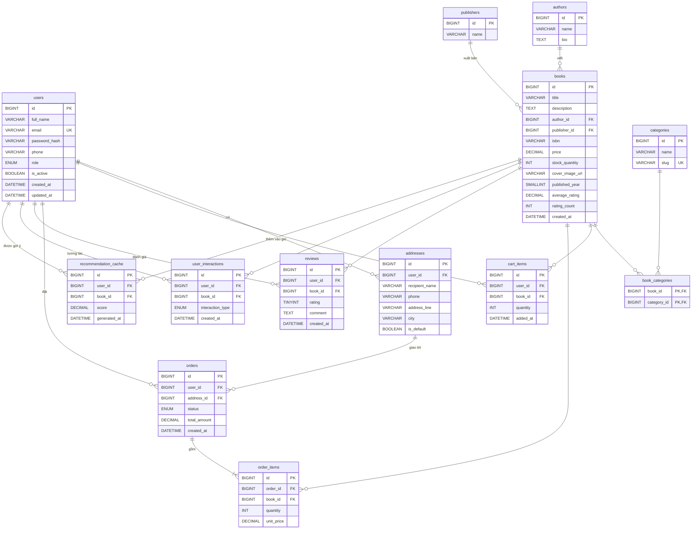

# Thiết kế cơ sở dữ liệu

- Hệ quản trị: MySQL 8.4, engine **InnoDB** (bắt buộc để khóa ngoại và transaction hoạt động), bảng mã `utf8mb4_unicode_ci`.
- Script tạo bảng: [`schema.sql`](../../schema.sql).
- Hibernate chạy ở chế độ `ddl-auto=validate`: ứng dụng chỉ kiểm tra entity khớp với bảng, không tự sửa cấu trúc. Mọi thay đổi bảng phải sửa trong `schema.sql`.

## Sơ đồ ERD

## Nhóm bảng

| Nhóm | Bảng | Mục đích |
|---|---|---|
| Người dùng | `users`, `addresses` | Tài khoản, phân quyền, địa chỉ giao hàng |
| Sản phẩm | `books`, `authors`, `publishers`, `categories`, `book_categories` | Thông tin sách và phân loại |
| Mua hàng | `cart_items`, `orders`, `order_items` | Giỏ hàng và đơn hàng |
| Hệ thống gợi ý | `reviews`, `user_interactions`, `recommendation_cache` | Dữ liệu đầu vào và kết quả của Collaborative Filtering |

## Mô tả các bảng

### users
Tài khoản người dùng. Một bảng dùng chung cho khách hàng và quản trị viên, phân biệt bằng cột `role`.

| Cột | Kiểu | Ràng buộc | Mô tả |
|---|---|---|---|
| id | BIGINT | PK, tự tăng | |
| full_name | VARCHAR(150) | NOT NULL | Họ tên |
| email | VARCHAR(150) | NOT NULL, UNIQUE | Email đăng nhập, lưu dạng chữ thường |
| password_hash | VARCHAR(255) | NOT NULL | Mật khẩu đã băm bằng BCrypt, không lưu mật khẩu gốc |
| phone | VARCHAR(20) | | Số điện thoại |
| role | ENUM('CUSTOMER','ADMIN') | NOT NULL, mặc định CUSTOMER | Vai trò |
| is_active | BOOLEAN | NOT NULL, mặc định TRUE | FALSE = tài khoản bị khóa, không đăng nhập được |
| created_at, updated_at | DATETIME | NOT NULL | Thời điểm tạo, cập nhật |

### addresses
Địa chỉ giao hàng. Một người dùng có nhiều địa chỉ, `is_default` đánh dấu địa chỉ mặc định. Xóa user thì xóa luôn địa chỉ (`ON DELETE CASCADE`).

### authors, publishers
Tác giả và nhà xuất bản. Mỗi sách thuộc **một** tác giả chính và **một** nhà xuất bản (quan hệ 1-nhiều). Xóa tác giả/NXB thì cột tương ứng trong `books` được đặt về NULL (`ON DELETE SET NULL`), sách không bị xóa theo.

### categories, book_categories
Thể loại sách. Một sách có thể thuộc **nhiều thể loại** và một thể loại chứa nhiều sách, nên dùng bảng trung gian `book_categories` (khóa chính ghép `book_id + category_id`). `slug` là tên không dấu dùng trên URL, ví dụ `van-hoc`.

### books
| Cột | Kiểu | Mô tả |
|---|---|---|
| title, description | VARCHAR(255), TEXT | Tên và mô tả sách |
| author_id, publisher_id | BIGINT, FK | Tác giả, NXB (cho phép NULL) |
| isbn | VARCHAR(20) | Mã ISBN |
| price | DECIMAL(12,2) | Giá bán hiện tại |
| stock_quantity | INT | Số lượng tồn kho |
| cover_image_url | VARCHAR(500) | Đường dẫn ảnh bìa |
| published_year | SMALLINT | Năm xuất bản |
| average_rating, rating_count | DECIMAL(3,2), INT | **Cột cache**: điểm trung bình và số lượt đánh giá, cập nhật khi có review mới. Giúp trang danh sách không phải tính `AVG()` mỗi lần hiển thị |

### cart_items
Giỏ hàng lưu trong database, theo từng user. Ràng buộc `UNIQUE(user_id, book_id)`: mỗi sách chỉ có một dòng trong giỏ, thêm lại thì cộng dồn `quantity`.

### orders, order_items
- `orders.status`: `PENDING` → `CONFIRMED` → `SHIPPING` → `DELIVERED`, hoặc `CANCELLED`.
- `order_items.unit_price` lưu **giá tại thời điểm mua**, không lấy từ `books.price`, vì giá sách có thể thay đổi sau này.
- Xóa đơn hàng thì xóa luôn chi tiết đơn (`ON DELETE CASCADE`).

### reviews
Đánh giá của người dùng, `rating` từ 1 đến 5 (`CHECK`). Ràng buộc `UNIQUE(user_id, book_id)`: mỗi người chỉ đánh giá một sách một lần. Đây là **phản hồi tường minh** (explicit feedback), tín hiệu mạnh nhất cho Collaborative Filtering.

### user_interactions
Nhật ký hành vi: xem (`VIEW`), thêm vào giỏ (`ADD_TO_CART`), mua (`PURCHASE`), yêu thích (`WISHLIST`). Đây là **phản hồi ngầm định** (implicit feedback): yếu hơn đánh giá nhưng có nhiều hơn, giúp giảm vấn đề cold-start khi người dùng chưa đánh giá sách nào. Có index trên `user_id` và `book_id` để truy vấn nhanh khi xây ma trận người dùng – sách.

### recommendation_cache
Lưu sẵn kết quả gợi ý (`score` là điểm dự đoán của thuật toán). Thuật toán chạy theo lô định kỳ rồi ghi vào bảng này, trang "Dành cho bạn" chỉ cần đọc ra, không phải tính lại Collaborative Filtering mỗi lần tải trang. Index `(user_id, score)` phục vụ truy vấn top-N theo từng người dùng.

## Ghi chú thiết kế

- **Engine InnoDB được khai báo rõ trong từng bảng**: máy chủ MySQL phát triển có engine mặc định là MyISAM, vốn bỏ qua khóa ngoại và không hỗ trợ transaction.
- **Không dùng index giảm dần (`DESC`)**: MySQL vẫn đọc index tăng dần theo chiều ngược lại khi gặp `ORDER BY score DESC`.
- **Mở rộng sau này**: nếu cần nhiều đồng tác giả, tách thêm bảng `book_authors` giống `book_categories`.
